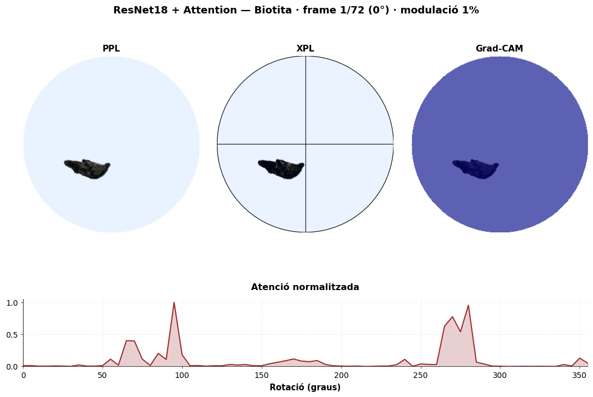
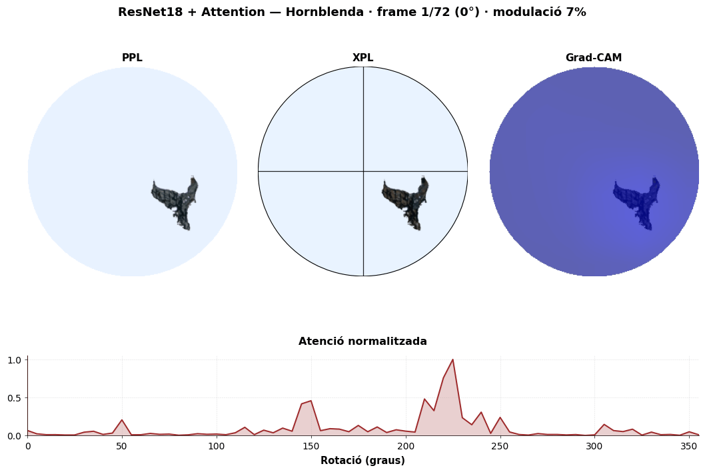
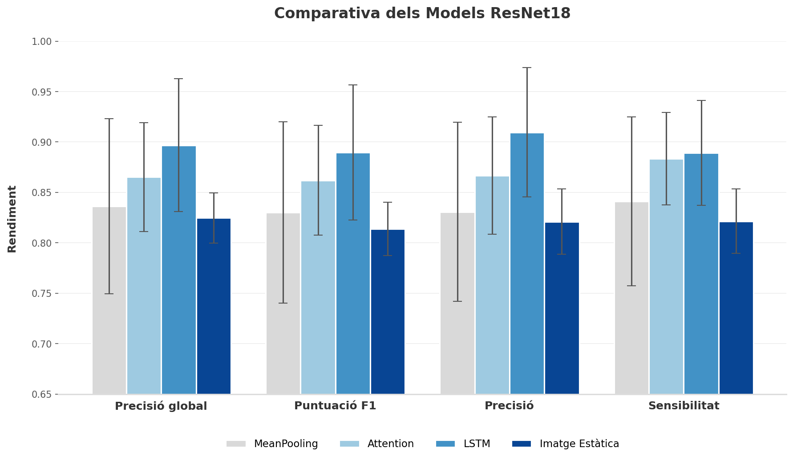
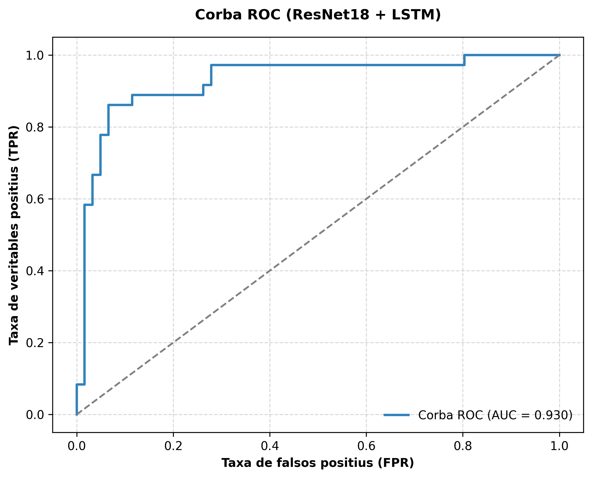
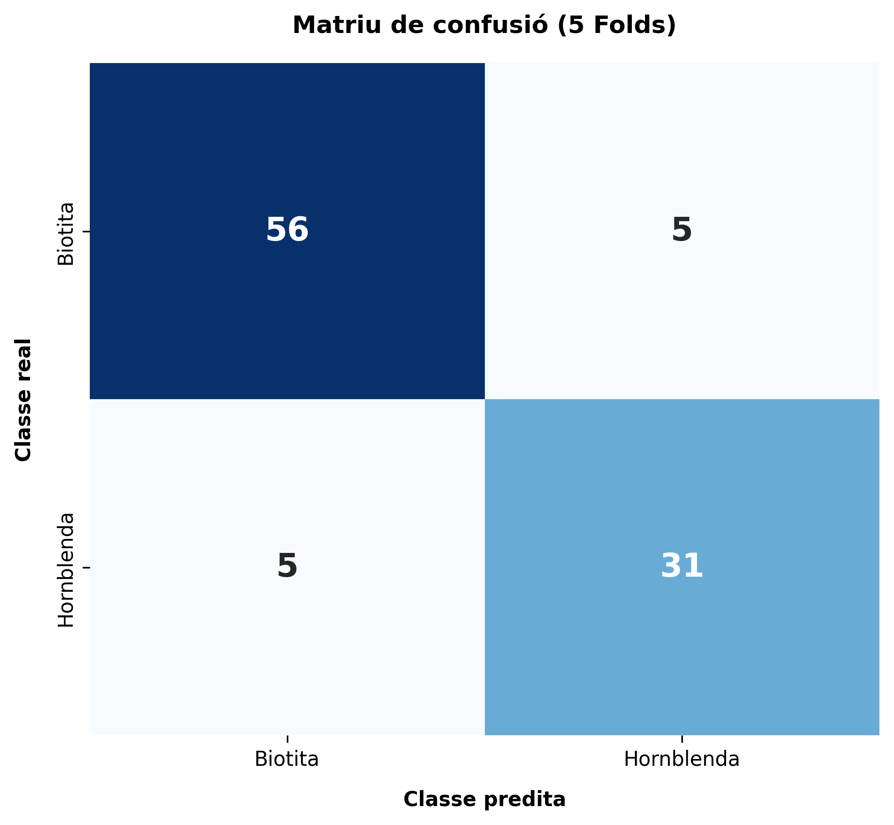

# Petrographic mineral classification from microscope videos

End-to-end Deep Learning pipeline to classify **biotite** vs. **hornblende** from 360° rotating petrographic microscopy video sequences (**PPL + XPL**). Includes automated data acquisition, semi-supervised crystal segmentation with SAM2, tensorization, 7 models trained under stratified 5-fold cross-validation, and evaluation/explainability (XAI) scripts.

> © 2026, Ariana Ganea — CC BY-NC-ND 4.0

---

## Visual overview and key results

Unlike static single-frame methods, modeling the full optical rotation sequence captures **pleochroism** (PPL) and **optical extinction** (XPL). Spatio-temporal Grad-CAM and attention maps verify that the network focuses on physically meaningful extinction angles rather than background artifacts:

| Biotite (Grad-CAM & Attention) | Hornblende (Grad-CAM & Attention) |
| :---: | :---: |
|  |  |

### Winning model performance: `ResNet18 + LSTM` (5-Fold Stratified CV)

With 97 isolated crystals, `ResNet50` overfitted early (~95% flat across temporal heads). Adopting `ResNet18` as a natural regularizer alongside explicit physical descriptors (`|PPL - XPL|`, temporal intensity derivatives, and sinusoidal angle encoding) revealed the expected architectural hierarchy: **Static < MeanPooling < Attention < LSTM**.

| Metric | Mean ± Std |
| :--- | :---: |
| **Accuracy** | `0.910 ± 0.064` |
| **Macro F1-Score** | `0.890 ± 0.067` |
| **Precision** | `0.897 ± 0.066` |
| **Recall** | `0.889 ± 0.052` |
| **ROC-AUC (Aggregated)** | `0.930` |

| Model Comparison (ResNet18) | ROC Curve (`ResNet18 + LSTM`) | Aggregated Confusion Matrix |
| :---: | :---: | :---: |
|  |  |  |

---

## Project structure

```
MINERAL_CLASSIFICATION_TFG/
├── README.md                       # This file
├── requirements.txt
├── train_models.py                 # Training of all 7 models (interactive CLI)
├── evaluate_models.py              # Evaluation & visualization generator
├── gradcam_attention.py            # Grad-CAM on ResNet50 + Attention
│
├── Dataset/
│   ├── METADADES.md                # Dataset schema & metadata
│   ├── download_minerals.py        # Automated frame scraper (Biotite + Hornblende)
│   ├── original_videos/            # [gitignored] Raw JPGs downloaded from Virtual Microscope
│   ├── segmented_minerals/         # [gitignored] Isolated crystal PNGs (SAM2)
│   └── segmented_minerals_tensor/  # [gitignored] Normalized `.pt` tensors for training
│
├── Segmentation/
│   ├── Codi_Segmentacion.py        # Interactive tool (SAM2 + OpenCV GUI)
│   ├── MirarSegmentacio.py         # Visual inspector for segmented masks
│   ├── TF2Tensor.py                # PNG sequences → `.pt` tensors
│   └── sam2_hiera_large.pt         # [gitignored] SAM2 model weights (download separately)
│
├── Models/                         # [gitignored] Checkpoints generated by `train_models.py`
│   ├── resnet18_final_attention/fold_{1..5}/best_model.pth
│   ├── resnet18_final_lstm/...
│   ├── resnet18_final_meanpooling/...
│   ├── resnet18_final_static_image/...
│   ├── resnet50_final_attention/...
│   ├── resnet50_final_lstm/...
│   └── resnet50_final_meanpooling/...
│
└── Results/            # Outputs from `evaluate_models.py` and `gradcam_attention.py`
    ├── sensibilitat_parametres_model.py     # Hyperparameter & feature sensitivity analysis
    ├── comparativa_*.png                    # Global model comparisons
    ├── gradcam/                             # Grad-CAM activation maps & GIFs
    └── resnet*_final_*/                   # Per-model plots (confusion matrices, fold metrics)
```

---

## Installation

Requires **Python ≥ 3.10**. Using a virtual environment is recommended.

```bash
pip install -r requirements.txt
```

For the segmentation stage, install **SAM2** directly from GitHub (not available on PyPI):

```bash
pip install git+https://github.com/facebookresearch/segment-anything-2.git
```

Download the `sam2_hiera_large.pt` checkpoint and place it inside `Segmentation/`.

---

## Complete pipeline

```text
[1] Download → [2] Segmentation → [3] Tensorization → [4] Training → [5] Evaluation
```

All main scripts (`train_models.py`, `evaluate_models.py`, `gradcam_attention.py`) must be run **from the project root** using relative paths.

### 1. Download original microscopy frames

```bash
python Dataset/download_minerals.py
```

Generates `Dataset/original_videos/<Mineral>/{PPL,XPL}/<roca>_rot<N>/frame_XXX.jpg` (72 PPL frames + 72 XPL frames per region, 5° rotation steps). Useful flags:

```bash
python Dataset/download_minerals.py --minerals biotite        # Biotite only
python Dataset/download_minerals.py --skip-existing           # Resume download
```

### 2. Semi-Supervised Segmentation with SAM2 (Interactive)

```bash
cd Segmentation
python Codi_Segmentacion.py
```

OpenCV GUI controls per thin section:

| Key / Action | Description |
| :--- | :--- |
| `R` | Select rectangular ROI over the crystal |
| `Enter` | Compute crystal mask with SAM2 |
| `C` | Clear current mask |
| `P` | Preview rigid rotation propagation across all 72 frames |
| `S` | Save crystal (exports 72 PPL PNGs + 72 XPL PNGs) |
| Vertical drag | Rotate virtual microscope stage manually |
| `N` | Move to next rock sample |
| `Esc` | Exit |

Output: `Dataset/segmented_minerals/<Mineral>/<roca>_rot<N>_crystal_<id>/{PPL_frames,XPL_frames}/`.

### 3. Tensor conversion

```bash
cd Segmentation
python TF2Tensor.py
```

Generates `Dataset/segmented_minerals_tensor/<Mineral>/<...>.pt` (see exact tensor schema in `Dataset/METADADES.md`).

### 4. Model training

```bash
python train_models.py
```

Interactive CLI menu. Selecting an option `[1–7]` trains the corresponding architecture with stratified 5-fold cross-validation and saves the best validation F1 checkpoints to `Models/<results_dir>/fold_<N>/best_model.pth`.

| Model | Bottleneck | Temporal Aggregation | Backbone |
| :--- | :---: | :--- | :---: |
| Attention ResNet18 | `1543 → 512` | 3-layer self-attention | ResNet18 |
| Attention ResNet50 | `6151 → 512` | 3-layer self-attention | ResNet50 |
| **LSTM ResNet18 (Best)** | `1543 → 512` | 1-layer LSTM (`hidden=512`) | ResNet18 |
| LSTM ResNet50 | `6151 → 512` | 2-layer LSTM (`hidden=256`) | ResNet50 |
| MeanPooling ResNet18 | `1543 → 512` | Temporal mean pooling | ResNet18 |
| MeanPooling ResNet50 | `6151 → 512` | Temporal mean pooling | ResNet50 |
| StaticImage ResNet18 | `1536 → 64` | Single frame baseline (frame 0 only) | ResNet18 |

**Shared hyperparameters**: `BATCH_SIZE=4`, `LR=1e-4`, `MAX_FRAMES=72`, weight decay `1e-4`, inverse-frequency weighted loss for class balancing. ResNet18 and StaticImage runs use `CosineAnnealingLR` and mixed precision (CUDA).

### 5. Evaluation and visualization

```bash
python evaluate_models.py
```

Interactive menu:

```
[1] ResNet18 + Attention
[2] ResNet50 + Attention
[3] ResNet18 + LSTM   (winner)
[4] ResNet50 + LSTM
[5] ResNet18 + MeanPooling
[6] ResNet50 + MeanPooling
[7] ResNet18 + StaticImage
[8] Evaluate ALL and generate global comparison
[0] Exit
```

**For every model** (saved to `Results/<model_dir>/`):
- `matrius_confusio_per_fold.png` — per-fold confusion matrices (raw + normalized)
- `matriu_confusio_global.png` — aggregated confusion matrix across all 5 folds
- `metriques_per_fold.png` — Accuracy / F1 / Precision / Recall across folds
- `resum_global.png` — mean ± std summary bar chart

**For the winning model (ResNet18 + LSTM)**, additionally generates:
- `corba_roc.png`— aggregated ROC curve
- `distribucio_confianca.png` — predicted probability confidence histogram
- `matriu_confusio_heatmap.png` — clean confusion matrix heatmap
- `analisi_errors_visual.png` — visual grid of residual false positives and false negatives

** When selecting `[8]`**, also exports to `Results/`:
- `comparativa_models.png` — overall model comparison
- `comparativa_resnet18_TFG.png` / `comparativa_resnet50_TFG.png` — thesis-styled comparisons

### 6. Grad-CAM

```bash
python gradcam_attention.py
```

Generates spatio-temporal Grad-CAM activation maps on `ResNet18 + Attention` under `Results/gradcam/` for Biotite and Hornblende samples.

---

## Reproducibility

- Global seed `seed=42` across `random`, `numpy` and `torch`
- `cudnn.deterministic = True`, `benchmark = False`
- Automatic hardware detection: `mps` (Apple Silicon) > `cuda` (NVIDIA) > `cpu`
- Stratified 5-fold splits via `StratifiedKFold(random_state=42)`
- Training-only video-level augmentations: cyclic temporal roll, horizontal/vertical flips, brightness jitter (`±10%`), and Gaussian noise (`σ=0.01`)

**Note on file ordering:** The original 3 `ResNet50` runs loaded files using raw `os.listdir(...)` (filesystem order), whereas `ResNet18` and `StaticImage` runs used `sorted(...)`. Both `train_models.py` and `evaluate_models.py` preserve this distinction via the `sort_files` flag to reproduce the exact original checkpoint splits.

---
## Roadmap

Residual error analysis shows that remaining misclassifications match physical limits of isolated optical microscopy (chloritization, oxyhornblende optical convergence, crystal twinning, and sub-pixel fragments). Planned future iterations include:

- [ ] Refactor into a modular package with `pyproject.toml` (`uv`) and YAML experiment configs
- [ ] Dual-input multi-scale architecture combining crystal mask + surrounding rock matrix (`groundmass`) context
- [ ] Feature Pyramid Network (FPN) backbone to handle small crystal grains
- [ ] Expansion to multi-class mineral classification
- [ ] Calibrated uncertainty quantification (e.g., conformal prediction) for human-in-the-loop workflows

## License

Code released under the [Creative Commons Reconeixement-NoComercial-SenseObraDerivada 4.0 Internacional (CC BY-NC-ND 4.0)](http://creativecommons.org/licenses/by-nc-nd/4.0/).

Original petrographic microscopy imagery is sourced from [The Open University Virtual Microscope](https://www.virtualmicroscope.org) and is subject to its own terms of use.
